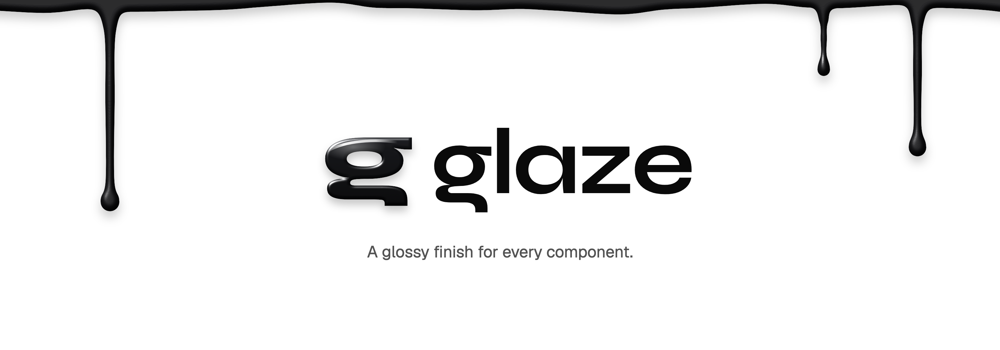

<picture>
  <source media="(prefers-color-scheme: dark)" srcset=".github/assets/glaze-banner-dark.png">
  
</picture>

<br />
<br />

Glaze is a React component library built on [shadcn/ui](https://ui.shadcn.com) and [Base UI](https://base-ui.com), themed entirely through CSS custom properties. One set of shared settings applies across every component; a component only diverges through a named adjustment.

Glaze Studio edits a theme against Nova, previews it on the real components and exports CSS.

This repository is a Vite monorepo containing the library, a web app, a showcase and Storybook.

**Live:** [showcase and theme builder](https://amit-kap.github.io/glaze/) · [Storybook](https://amit-kap.github.io/glaze/storybook/)

## Contents

- [Features](#features)
- [Requirements](#requirements)
- [Installation](#installation)
- [Getting started](#getting-started)
- [Theming](#theming)
- [Development](#development)
- [License](#license)

## Features

- **Accessible primitives.** Components are built on Base UI and follow shadcn/ui conventions.
- **Shared theming.** One set of settings changes every component; exceptions are named and visible.
- **Nova, one theme.** A shadcn-based default look; change it in Studio or by hand and save your own theme.
- **Mode and density.** Light and dark modes, plus comfortable and compact density, combine freely.
- **Scoped theming.** Apply a custom theme to a single section of the page.

## Requirements

- React 19
- Tailwind CSS 4

Both are peer dependencies supplied by your project.

## Installation

In your project's folder, run:

```bash
npx @amit-kap/glaze init
```

This installs the package, imports Glaze's styles into your main CSS file (the one with `@import "tailwindcss"`), and wraps your app in `ThemeProvider`. Other options: `--mode light|dark|system`, `--density comfortable|compact`, `--config glaze.config.json` (your own theme, see below), and `--css` / `--entry` to point at the files yourself. Running it again updates the wiring.

If your entry file isn't the usual `createRoot(…).render(<App />)` shape, it prints the lines to add instead.

To set it up by hand instead, install the package and follow [Getting started](#getting-started):

```bash
npm install @amit-kap/glaze
```

Each release is also tagged in this repository, so it can be installed from GitHub:

```bash
npm install github:amit-kap/glaze#v<version>
```

## Getting started

### 1. Import the styles

Add the following to your project's main CSS file:

```css
@import "@amit-kap/glaze/globals.css";
```

- `globals.css` includes Tailwind, the tokens and Nova. Use it in place of your own `@import "tailwindcss"`.
- Tailwind detects the classes used inside Glaze components automatically. Your project's files are detected as usual.
- A custom theme is a second `@import`, after this one.

### 2. Enable the theme

Wrap the application in `ThemeProvider`:

```tsx
import { ThemeProvider } from "@amit-kap/glaze/theme"

;<ThemeProvider defaultMode="system">
  <App />
</ThemeProvider>
```

The viewer's choice is persisted in `localStorage` under `storageKey` (default `"glaze"`); pass `false` to disable persistence.

Outside React, set the attribute directly: `<html data-theme="nova">`.

### 3. Use components

```tsx
import { Button } from "@amit-kap/glaze/components/button"
```

## Theming

### Theme attributes

Theme, mode and density are controlled by attributes on `<html>` and can be combined freely:

| Setting | Attribute      | Values                                                             |
| ------- | -------------- | ------------------------------------------------------------------ |
| Theme   | `data-theme`   | none or `nova` (default), or the name of a custom theme you import |
| Mode    | `class="dark"` | none (light), `dark`                                               |
| Density | `data-density` | none or `comfortable`, `compact`                                   |

```html
<html data-theme="nova" class="dark" data-density="compact"></html>
```

`ThemeProvider` manages these attributes for you. The same attributes can be applied to any element to theme only that part of the page:

```html
<section data-theme="my-theme">…</section>
```

### One theme: Nova

Nova is the only built-in theme. It is a shadcn-based appearance with Geist, 32px controls and 10px corners, in light and dark. Everything you change is a saved theme on top of it — made in Studio or written by hand.

### Switching at runtime

```tsx
import { useTheme } from "@amit-kap/glaze/theme"

const { mode, setMode, resolvedMode, density, setDensity } = useTheme()

setMode("dark") // "light" | "dark" | "system"
setDensity("compact") // "comfortable" | "compact"
```

`setTheme("my-theme")` switches to a custom theme you have imported.

### Preventing a flash on load

Add the inline script to `<head>` so the saved mode is applied before the first paint. Pass the same options as the provider:

```tsx
import { themeScript } from "@amit-kap/glaze/theme"

;<script dangerouslySetInnerHTML={{ __html: themeScript() }} />
```

### Custom themes

The quickest way is a config (`glaze.config.json`): the inputs to change, starting from Nova. Build one in the showcase's Customize panel, or see `packages/ui/glaze.config.example.json`. Then:

```bash
npx @amit-kap/glaze init --config glaze.config.json
```

It generates `<name>.css` and wires it in; `npx glaze theme glaze.config.json` regenerates just the CSS. In this repository, `npm run theme -- <config.json>` does the same.

To write a theme by hand, copy `packages/ui/src/styles/themes/nova.css` and change the values you need:

1. Create `<name>.css` in your project.
2. Under `[data-theme="<name>"]`, set the shared inputs (`--background`, `--card`, `--foreground`, `--muted-foreground`, `--border`, `--brand`, `--brand-ink`, `--radius`, …) for both light and dark mode.
3. Import the file and set `data-theme="<name>"`.

`--primary` follows `--brand` and `--primary-foreground` follows `--brand-ink`
until the theme sets them itself. Setting `--primary` is how a theme separates
action color from identity; resetting it means removing the declaration.

The full list of settings, with descriptions and the components that use each
one, is `packages/ui/src/theme/catalog.ts`. The specification is
`glaze-architecture.md`.

## Development

### Repository structure

| Path             | Contents                                         |
| ---------------- | ------------------------------------------------ |
| `packages/ui`    | The Glaze library: components, tokens and themes |
| `apps/web`       | Web app (the target for `shadcn add`)            |
| `apps/showcase`  | One-page demo of the components                  |
| `apps/storybook` | Storybook with a story for every component       |

### Architecture

Layers, the theme model, the settings and component rules are defined in
`glaze-architecture.md`. Read it before changing components, tokens or themes.
Earlier proposals are in `archive/`; do not implement them.

The settings catalog is `packages/ui/src/theme/catalog.ts`. Storybook and the
CSS export read it, so a new setting or a renamed one is added there first.
`npm run check:catalog` verifies that every catalog entry exists in the CSS,
that everything Nova sets is editable, and that `theme/consumers.ts` matches
what the components actually use (`--write` regenerates it).

### Adding components

```bash
npx shadcn@latest add button -c apps/web
```

This places the component in `packages/ui/src/components` with stock shadcn classes. Convert it to Glaze tokens, then verify:

```bash
npm run convert:tokens -- button.tsx   # map stock classes to system utilities
npm run check:tokens                   # fail on any class the token contract forbids
```

Anything the converter cannot map becomes a component token (see "Converting stock shadcn code" in the specification). Every new component also needs a matching `<component>.stories.tsx`.

### Motion

Every duration and easing comes from a motion token; `check:tokens` rejects literal timings and `transition-all`. Pick the token by what moves:

| Motion                                              | Duration                                                                         | Easing             | Used by                                                                                                     |
| --------------------------------------------------- | -------------------------------------------------------------------------------- | ------------------ | ----------------------------------------------------------------------------------------------------------- |
| Hover, focus and colour changes                     | default (`--duration-base`)                                                      | `ease-standard`    | buttons, toggles, inputs, tab labels                                                                        |
| A highlight or indicator travelling between targets | `--duration-fast` (highlight, hover pill), `--duration-moderate` (tab indicator) | `ease-spring`      | menu highlight (`highlight-scope`), tab hover pill (`highlight-scope` following the pointer), tab indicator |
| A popup or overlay fading in                        | `--duration-fade-*`                                                              | tw-animate default | menus, select, combobox, popover, tooltip, hover card, dialogs, sheet overlay                               |
| The same popup leaving                              | `--duration-exit-*` on `data-closed`                                             | tw-animate default | as above                                                                                                    |
| A panel resizing                                    | `--duration-moderate`                                                            | `ease-standard`    | collapsible, accordion                                                                                      |
| A large surface sliding                             | component tokens (`--drawer-duration`, …)                                        | `ease-enter`       | drawer, sheet                                                                                               |

Rules:

- **The bigger the thing that moves, the slower it moves.** Small state changes use `fast`, travelling indicators `moderate`, surfaces `slow`.
- **Exits are quicker than enters** (`--motion-exit-scale`, 0.75), so a dismissal reads as final rather than the entrance replayed.
- **Reduced motion keeps fades and drops movement.** `--motion-scale` goes to 0, so `--duration-*` stops; `--fade-scale` stays 1, so `--duration-fade-*` and `--duration-exit-*` keep running, and popups lose their zoom and slide but still fade. Use a `fade` duration only for opacity and colour.
- **Move with `transform`, `opacity` and colour.** Animate layout (`width`, `height`, insets) only when the size itself is the information (progress, collapsible, the tab indicator's width).
- **Weight changes reserve their width.** A label that gets heavier with state goes through `reserveWeight()` (`lib/label.ts`), so its neighbours never shift.
- **Shared patterns are utilities:** `highlight-scope` with `useHighlightLayer()` (one highlight per list: the hook measures the current row, the utility draws and moves the layer) and `icon-swap` (two-icon crossfade). Reuse them instead of hand-rolling the effect.

### Showcase

`apps/showcase` presents the library in the style of fluidfunctionalism.com: a centre column of live components and a floating settings panel in the top right (Theme, Mode, and a Customize section that builds and exports your own theme). It's published at [https://amit-kap.github.io/glaze/](https://amit-kap.github.io/glaze/).

```bash
npm run dev -w showcase     # http://localhost:5180
```

### Storybook

Every component in `packages/ui` has a story in `apps/storybook/src/stories`. It's published at [https://amit-kap.github.io/glaze/storybook/](https://amit-kap.github.io/glaze/storybook/).

```bash
npm run dev -w storybook    # http://localhost:6006
npm run build -w storybook  # static build in apps/storybook/dist
```

The toolbar provides the **Mode** and **Density** switches. Link to a specific state with `&globals=mode:dark;density:compact`.

Both are deployed to GitHub Pages on every push to `main` (`.github/workflows/pages.yml`).

### Dependencies

Dependabot (`.github/dependabot.yml`) opens weekly PRs: one for all minor and patch updates, one per major update, and one for GitHub Actions. CI runs on each; merge when it passes.

### Releasing

Releases run in GitHub Actions (`.github/workflows/release.yml`):

1. Bump `version` in `packages/ui/package.json` and merge it to `main`.
2. The Release workflow sees that `v<version>` doesn't exist yet. It checks, builds, publishes to npm with [trusted publishing](https://docs.npmjs.com/trusted-publishers) (no token or 2FA code; the package gets provenance), then commits the build to the `release` branch and tags it `v<version>`.

It can also be started by hand from the Actions tab; a version that's already tagged is skipped. One-time setup: on npmjs.com, add a trusted publisher to `@amit-kap/glaze` for this repository and the workflow file `release.yml`.

To release from your machine instead: `npm run release:glaze -- --npm --push` (prompts for your npm two-factor code).

`npm run build:glaze` builds `packages/ui/dist` without releasing.

Notes:

- npm installs a Git repository from its root, so releases live on the `release` branch, which contains only the built package.
- The published package has its own README (`packages/ui/PACKAGE_README.md`) and `THIRD_PARTY_NOTICES.md`. Keep the package README in step with this one.

## License

MIT
