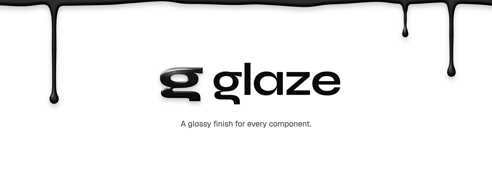

<picture>
  <source media="(prefers-color-scheme: dark)" srcset=".github/assets/glaze-banner-dark.png">
  
</picture>

<br />
<br />

Glaze is a React component library built on [shadcn/ui](https://ui.shadcn.com) and [Base UI](https://base-ui.com), themed entirely through CSS custom properties. One set of shared settings applies across every component; a component only diverges through a named adjustment.

[Glaze Studio](https://glaze-studio.amitkap.com) edits a theme against the default Nova look, previews it on the real components and exports it.

**Live:** [Glaze Studio](https://glaze-studio.amitkap.com) · [Components](https://amit-kap.github.io/glaze/) · [Storybook](https://amit-kap.github.io/glaze/storybook/)

## Features

- **Accessible primitives.** Built on Base UI, following shadcn/ui conventions.
- **Shared theming.** One set of settings changes every component; exceptions are named and visible.
- **Nova and your own themes.** Nova is the one built-in theme. Make yours in Studio or by hand.
- **Mode, density and scope.** Light and dark, comfortable and compact, and a theme can apply to one section of a page.

## Quick start

Needs React 19 and Tailwind CSS 4. In your project's folder:

```bash
npx @amit-kap/glaze init
```

This installs the package, imports the styles and wraps your app in `ThemeProvider`. Then use a component:

```tsx
import { Button } from "@amit-kap/glaze/components/button"
```

Setting it up by hand, switching modes at runtime, avoiding a flash on load and writing your own theme are covered in the [package README](packages/ui/PACKAGE_README.md).

## Your own theme

Make one in [Glaze Studio](https://glaze-studio.amitkap.com), then Export. Download the config and apply it:

```bash
npx @amit-kap/glaze init --config glaze.config.json
```

Settings, with descriptions and the components that use each one, are in `packages/ui/src/theme/catalog.ts`. The design is in [docs/architecture.md](docs/architecture.md).

## Repository

A Vite monorepo:

| Path             | Contents                                         |
| ---------------- | ------------------------------------------------ |
| `packages/ui`    | The Glaze library: components, tokens and themes |
| `apps/studio`    | Glaze Studio, the theme editor                   |
| `apps/showcase`  | One tile per component                           |
| `apps/storybook` | Storybook with a story for every component       |
| `apps/web`       | Web app (the target for `shadcn add`)            |

- [docs/development.md](docs/development.md): commands, adding components, motion, releasing
- [docs/studio.md](docs/studio.md): what Studio does and how it is deployed
- [docs/architecture.md](docs/architecture.md): the design and the rules components follow

## License

MIT
