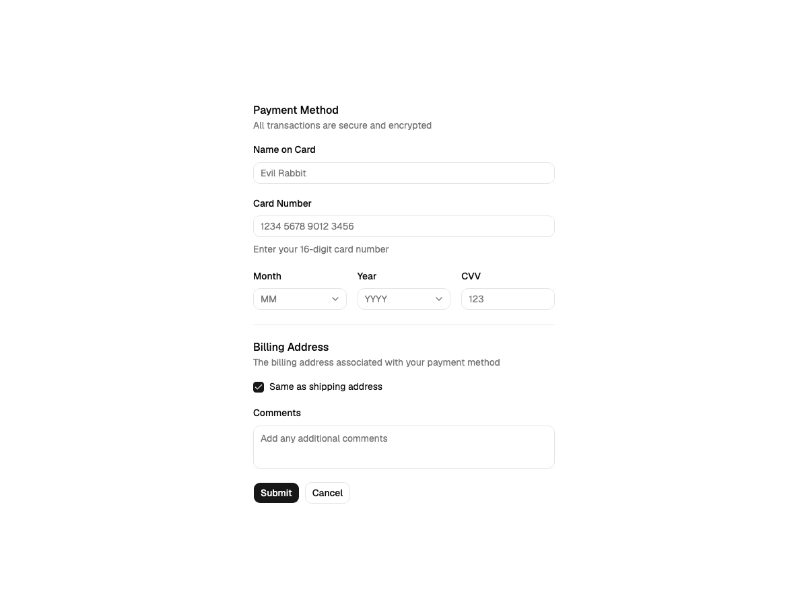
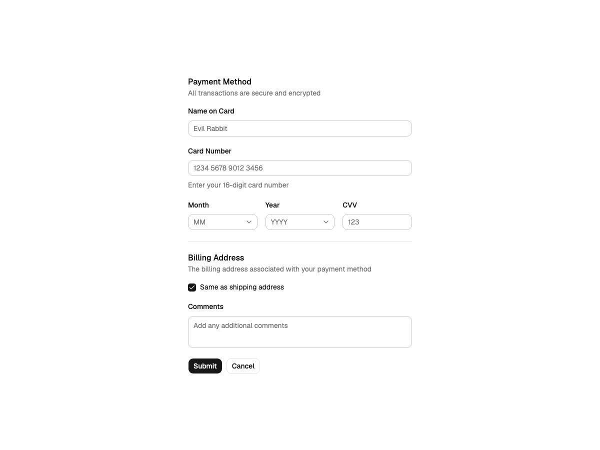

# Colour refactor: before and after

Snapshot taken while migrating the colour layer to V4: `--canvas` became
`--background`, `--primary` became the value components read, and Nova's hidden
light-mode pins were deleted. The rest of the library is unchanged, so this file
records where the pixels moved and why.

Compare on `components-field--demo`, the densest place fields, dividers,
surfaces and text appear together:

- before: `?path=/story/components-field--demo&globals=theme:nova;mode=light` on `main`
- after: the same URL on `v4`

## Result

| Theme and mode | Difference |
| --- | --- |
| Nova, dark | None. The screenshots are byte-identical (`5c86410f…`). |
| Vega, light and dark | None. Vega pins its light neutrals, so both modes are byte-identical. |
| Maia, light | None. Every probed value matches. |
| gr8r, light | One value: `--ring` goes from 100% brand (`oklab(0.53 …)`) to 37% brand (`oklab(0.817 …)`). gr8r was the only theme whose light block left the ring unpinned. |
| Nova, light | Only the field borders: 0.38% of pixels, largest channel change 30/255. |

The Nova light change is the field border: `--input` is now derived (0.829)
instead of pinned to shadcn's 0.922. The border is still lighter than the text
and darker than a divider, which is the rule the other eight themes already
followed. Nothing else in the screenshot moves.

The gr8r ring is the recipe doing what it says: 37% of the brand mixed with the
page is the percentage that reproduces shadcn's neutral focus ring, and gr8r's
light block had no ring of its own to preserve. The old 100% mix painted the
ring in the full brand colour, which was the one light-mode value no theme
pinned.

## Values

Resolved in a browser on the token page (Nova, light).

| Setting | Before | After | Note |
| --- | --- | --- | --- |
| `--input` | `0.922` (pinned) | `0.829` (derived) | Same as `--border-strong`; Nova no longer pins it. |
| `--secondary-foreground` | `0.205` (pinned) | `0.145` (ink) | Text on quiet fills is now the main text colour. |
| `--accent-foreground` | `0.205` (pinned) | `0.145` (ink) | Same rule as above. |
| `--sidebar-accent-foreground` | `0.205` (pinned) | `0.145` (ink) | Same rule as above. |
| `--sidebar-accent` | `0.97` (pinned) | `0.9556` (derived) | 3.5% ink over the sidebar, the same recipe as `--secondary`. |
| `--ring` | `0.708` (pinned) | `0.70585` (derived) | Below one JND. |
| `--muted`, `--secondary`, `--accent` | `0.97` | `0.970075` | Below one JND. |
| `--sidebar` | `0.985` | `0.985038` | Below one JND. |
| `--border-strong` | `0.829` | `0.829` | Unchanged; the recipe is now shared by every theme. |

Every other probed value (`--background`, `--border`, `--brand`, `--primary`,
`--muted-foreground`, `--severity-high`, …) is identical.

Nova dark matches exactly. Its `--input` was always derived, so deleting the pin
block changed nothing there.

## Mixes

The light mode now uses one set of recipes, in `tokens.css`:

| Mix | Light | Dark | Produces |
| --- | --- | --- | --- |
| `--mix-fill` | 3.5% | 8% | `--secondary`, `--accent`, sidebar highlight |
| `--mix-muted` | 3.5% | 15% | `--muted` |
| `--mix-sidebar` | 1.75% | 7% | `--sidebar` |
| `--mix-strong` | 12% | 6% | `--border-strong`, `--input` |
| `--mix-ring` | 37% | 53% | `--ring` |

These are inherited settings: a theme can raise or lower any of them, and the
catalog lists them with the values they produce.
